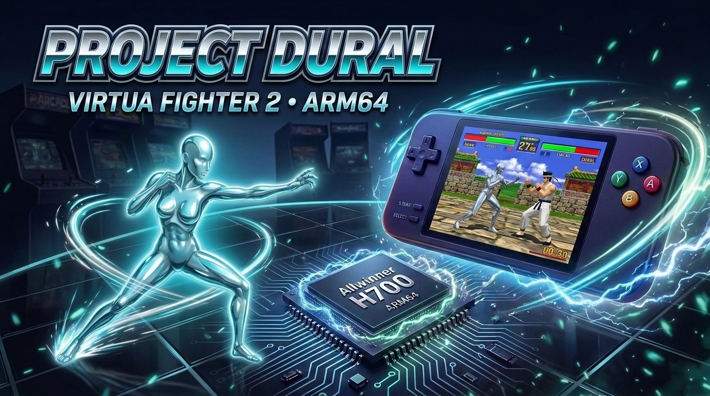

<p align="center">
  
</p>

# ProjectDural — Virtua Fighter 2 ARM64 / Anbernic RG34XX Port

[](https://github.com/DanimanX/ProjectDural/actions/workflows/build-arm64.yml)

An **ARM64 (AArch64) & OpenGL ES 2.0** handheld port of [vf2-recomp](https://github.com/mr-finster/vf2-recomp) (static recompilation of **Virtua Fighter 2** — Sega Model 2A-CRX, Version 2.1), engineered for the **Anbernic RG34XX** (**Allwinner H700** / Mali-G31 MP2, 720×480 3:2 GBA form factor) and compatible Linux **PortMaster** handhelds.

Unlike our earlier [DaytonaArm](https://github.com/DanimanX/DaytonaArm) port (which required PC-side AOT C++20 `.so` module compilation), **ProjectDural** leverages `vf2-recomp`'s built-in **SLJIT ARM64** backend (`sljitNativeARM_64.c`) to statically recompile VF2's Intel i960 program directly into native AArch64 machine code in memory at startup (~30–80 ms, **zero PC pre-build required**). Simply drop your own legal MAME `vf2.zip` into `roms/` and play!

> **Bring Your Own Data (BYOD):** No copyrighted ROMs or ROM-derived compiled code are included in this repository or its releases. You must supply your own legally dumped MAME `vf2.zip` (Version 2.1) ROM set.
>
> *"Virtua Fighter 2"* and *"Sega Model 2"* are trademarks of their respective owners. This project is independent and not affiliated with SEGA.

---

## Hardware Feasibility & 57.52 FPS Performance on Allwinner H700 (Anbernic RG34XX)

Sega Model 2A runs Virtua Fighter 2 at a native arcade frame rate of **57.524 FPS** (`17.38 ms` frame budget).

| Subsystem | Anbernic RG34XX Hardware | Sega Model 2A Arcade Target | ProjectDural Engineering |
|---|---|---|---|
| **CPU** | **Allwinner H700** — 4× ARM Cortex-A53 @ 1.5 GHz (`aarch64`) | Intel i960-KB @ 25 MHz + Fujitsu TGP MB86234 @ 16.67 MHz + Motorola 68000 @ 11.29 MHz | **On-device SLJIT ARM64 static recompilation** (`src/rec/i960_native.cpp` + `vf2_map.cpp`) compiles the i960 program to native AArch64 in ~30–80 ms at startup with deterministic `-fno-fast-math -ffp-contract=off` float semantics. |
| **4-Core Pipeline** | All 4 Linux cores schedulable (`pthread_setaffinity_np`) | Main CPU + Geometrizer + 68000/SCSP Sound + System 24 2D | **Core 0:** SLJIT i960 + TGP + Geometrizer + GLES 2.0 submit · **Core 1:** Auxiliary `row_pool` worker · **Core 2:** Decoupled `SoundWorker` (68000 + SCSP + DSP, ~18 MB slim ROM clone) · **Core 3:** Adaptive-rate SDL2 audio callback. |
| **GPU** | **ARM Mali-G31 MP2** (OpenGL ES 2.0 / 3.2, **no Vulkan**) | Model 2A 3D polygon rasterizer + System 24 4-layer tilemaps | Desktop `SDL_GPU` (Vulkan) does not run on H700. ProjectDural implements a dedicated **OpenGL ES 2.0 / GLSL ES 1.00** renderer (`platform/arm64/gpu_gles.cpp`) with strictly decreasing depth ranks (`GL_GREATER` reproducing exact Model 2 front-to-back priority), scissor/program/texture batching, 4-bit swizzled texture cache, 128×2048 RGBA palette LUT, and ARM64 NEON 2D layer swizzle (`vqtbl1q_u8`). |
| **RAM** | **1 GB LPDDR4** (~750–850 MB free) | ~105.5 MB ROM regions + Model 2A RAM + GPU textures | **~145–175 MB total peak RSS** (Core 2 `SoundWorker` clones only `AUDIOCPU` + `SAMPLES` ~8.5 MB, saving ~97 MB RAM). |
| **Display** | 3.4" IPS **720×480** (3:2, 60 Hz) | 496×384 (4:3, 57.524 Hz) | **Native 3:2 Widescreen (`576×384` → `720×480` at 1.25×)** with true widened Model 2A 3D frustum + painted character select sides (`assets/backgrounds/select.png`), plus `4:3 Original` (`620×480`) and `Stretch` toggles. |
| **Controls** | D-Pad + A/B/X/Y + L1/L2/R1/R2 (**no analog sticks**) | 8-way Stick + Guard / Punch / Kick | **Saturn / VF ergonomic layout** (`X`=Guard, `A`=Punch, `B`=Kick) with single-button **throw & combo macros** (`Y`=G+P, `R1`=P+K, `L1`=G+K, `R2`=P+K+G), plus 2P USB/BT gamepad hot-plug. |

### Projected Frame-Time Budget on Allwinner H700 (`17.38 ms` @ 57.52 FPS)

| Execution Path | Core 0 (SLJIT i960+TGP+Geo+GL) | Core 2 (68k+SCSP+DSP) | Mali-G31 GPU | Expected FPS |
|---|---|---|---|---|
| **ProjectDural GLES 2.0 + SLJIT ARM64 + Core 2 SoundWorker** | ~6.5 – 9.5 ms | ~3.5 – 5.0 ms *(parallel)* | ~3.5 – 6.0 ms | **57.52 FPS locked** *(100% arcade speed)* |
| **ProjectDural GLES 2.0 (SCSP Reverb DSP OFF)** | ~6.5 – 9.5 ms | ~2.0 – 3.0 ms *(parallel)* | ~3.5 – 6.0 ms | **57.52 FPS locked** *(extra battery headroom)* |
| **CPU Software Rasterizer (`model2_video` fallback)** | ~35 – 65 ms | ~3.5 – 5.0 ms | — | ~15 – 28 FPS *(diagnostic fallback only)* |

### Tested Devices (Real Hardware)
Measured on retail handhelds with the PortMaster `aarch64` build. The arcade frame rate is `57.524 FPS` (100% speed).

| Device | SoC | GPU | GPU module (GLES driver) | OS / CFW | Tested performance |
|---|---|---|---|---|---|
| **Anbernic RG34XX** | Allwinner H700 (4× Cortex-A53 @ 1.5 GHz) | ARM Mali-G31 MP2 | `libmali.so` (ARM Bifrost userspace blob) + `mali_kbase` kernel module | **Knulli** | **57.52 FPS — full speed** |
| **Powkiddy RGB30** | Rockchip RK3566 (4× Cortex-A55 @ 1.8 GHz) | ARM Mali-G52 2EE | `libmali.so` (ARM Bifrost G52 userspace blob) + `mali_kbase` kernel module | **ArkOS** | **57.52 FPS — full speed** |
| **TrimUI Smart Pro** | Allwinner A133P (4× Cortex-A53 @ 1.8 GHz) | Imagination PowerVR GE8300 | `libGLESv2.so` + `libsrv_um.so` (Imagination PowerVR userspace) + `pvrsrvkm` kernel module | **Spruce** | **50–56 FPS** with all 4 cores online (see note) |

The two Mali (Bifrost) handhelds hold the game at its native `57.52 FPS`. The TrimUI Smart Pro's A133P / PowerVR GE8300 is the slowest of the three, settling at `50–56 FPS`, so its fights run a little below arcade pacing.

> **TrimUI Smart Pro on Spruce: cores 1–2 are hotplugged off.** Spruce boots with `online: 0,3`, and the port's threads are pinned to cores 0–3 by role (main / emulation / sound / audio). When a pinned core does not exist the pin fails silently and every thread collapses onto core 0 — the whole 4-thread pipeline then shares one CPU and the game measured **26–28 FPS**. The launcher now brings cores 1–2 up for the session (and puts them back afterwards), and the binary resolves each role against the cores actually online, so the same hardware reaches **50–56 FPS**. If you see roughly half speed, check `cat /sys/devices/system/cpu/online` — it should be `0-3` while the port runs.

### Compatible Handhelds
Compiled for **`aarch64-linux-gnu` / `glibc <= 2.28`** (statically linking `libc++` and `zlib 1.3.1` via Zig, dynamically loading the firmware's hardware-accelerated `libSDL2-2.0.so.0` and OpenGL ES 2.0):
- **Anbernic XX (Allwinner H700):** RG34XX, RG35XX Plus / H / SP / 2024, RG40XX H / V, RG CubeXX, RG28XX (muOS, Knulli, ROCKNIX, Stock OS)
- **Rockchip RK3566 (Cortex-A55 @ 1.8 GHz):** Powkiddy RGB30 / X55, Anbernic RG353 / RG503, Miyoo Flip
- **Allwinner A133P / TrimUI:** TrimUI Smart Pro, TrimUI Brick
- **ARM64 SBCs:** Raspberry Pi 4 / 5, Orange Pi Zero 2W / 3 (64-bit Linux)

---

## Architecture: Standalone On-Device SLJIT + 4-Core Pipeline

```text
  [Distributable PortMaster ZIP — 100% ROM-free & Game-Code-Free]
    projectdural/vf2.aarch64  (zero PC .so pre-build needed!)
         │
         ├──► Startup (~50 ms): SLJIT ARM64 compiles user's roms/vf2.zip i960 -> native AArch64
         │
         ├──► Core 0: SLJIT i960 + TGP + Geometrizer + NEON 2D + GLES 2.0 Mali-G31 batch submit
         ├──► Core 1: Auxiliary row_pool worker
         ├──► Core 2: Decoupled SoundWorker (68000 + SCSP + Stereo Reverb DSP, ~8.5 MB ROMs)
         └──► Core 3: Adaptive-rate 44.1→48 kHz SDL2 audio callback
```

---

## Quick Start (Anbernic RG34XX / PortMaster)

### 1. Build the Distributable PortMaster Runtime (on Linux x86_64)
Requires `curl`, `git`, `python3`, `tar`, `zip`, `binutils`. Zig 0.17.0, SDL2 2.32.10 headers, zlib 1.3.1, and Dear ImGui are fetched automatically at pinned versions/commits:

```bash
tools/build-arm64.sh
```

This creates **`dist/ProjectDural-PortMaster-aarch64.zip`** (zero ROMs, zero game code) containing:
- `Virtua Fighter 2.sh` (PortMaster launcher with `performance` CPU governor lock)
- `projectdural/vf2.aarch64` (ARM64 Cortex-A53, SLJIT ARM64, OpenGL ES 2.0, NEON, max `GLIBC_2.28`, static `zlib` & `libc++`)
- `projectdural/assets/backgrounds/select.png` (3:2 widescreen character select sides)
- `projectdural/gamecontrollerdb.txt`, `port.json`, `gameinfo.xml`, and licences

### 2. Extract to Your Handheld & Copy Your Legal `vf2.zip`
1. Extract `ProjectDural-PortMaster-aarch64.zip` into your PortMaster `ports/` folder (e.g., `/mnt/sdcard/ports/` on muOS, `/userdata/roms/ports/` on Knulli, `/roms/ports/` on ArkOS).
2. Copy your legally dumped MAME `vf2.zip` (Version 2.1) into `ports/projectdural/roms/vf2.zip`.
3. Launch **Virtua Fighter 2** from Ports!

---

## Default Controls (Anbernic RG34XX)

All gameplay buttons can be rebound inside **Menu → Controls**:

| Action | Anbernic RG34XX Default | Notes |
|---|---|---|
| **Move / Crouch / Jump** | **D-Pad** *(or Left Stick)* | Arcade 8-way |
| **Guard (G)** | **X (West)** | Saturn-style thumb layout |
| **Punch (P)** | **A (South)** | |
| **Kick (K)** | **B (East)** | |
| **Throw Macro (G+P)** | **Y (North)** | Single-button throw |
| **P+K / G+K Macros** | **R1 / L1** | |
| **All Three (P+K+G)** | **R2** | |
| **Start / Insert Coin** | **Start / Select** | Free Play enabled by default |
| **Pause & Settings Menu** | **Start + Select** *(or Menu button)* | Saves `settings.ini` & NVRAM |
| **Cabinet Test / Service** | **Select + Y** / **Select + X** | |

---

## In-Game Features & Cheats

Open the in-game menu (**Start + Select** or **Menu**) to configure:
- **Display:** `3:2 Widescreen` (`576×384`), `4:3 Original` (`496×384`), or `Stretch Fill`; GLES 2.0 vs CPU 3D toggle; Smooth Backdrop Filter; HUD Hide; VSync; `57.52 Hz` vs `60.0 Hz` pacing; FPS/Polygon overlay.
- **Audio:** Master / Music / SFX volumes, Mute, and **SCSP Stereo Reverb DSP** toggle.
- **Arcade Settings:** Free Play vs Coin mode, Difficulty, 1P Rounds to Win, Game Version (`v2.1` / `Original`), Debug Mode, and Hold Test Button.
- **Cheats & Secrets:** Unlock **Dural**, **MUE**, or **KOJAC** on Akira's slot; **Random Fighters** (P1 / CPU Opponents / Both); **Fight Switches** (Infinite Energy, One-Hit KO, No Time Limit, Tiny/Huge Ring Width).

---

## Upstream Attribution & Licence

- Upstream project: **[mr-finster/vf2-recomp](https://github.com/mr-finster/vf2-recomp)** — original static recompilation of Sega Model 2A Virtua Fighter 2 (SLJIT i960, TGP, M68000, SCSP, and hardware runtime).
- Licence: **[MIT](LICENSE)** for ProjectDural / `vf2-recomp` code; MAME components keep their **BSD-3-Clause** licence (`third_party/mame/README.md`); SLJIT keeps **BSD-2-Clause** (`third_party/sljit/LICENSE`); `assets/backgrounds/select.png` is by Mr Finster under **CC BY 4.0**.
- The licence does **not** cover Virtua Fighter 2 itself; ROM sets are never distributed.
